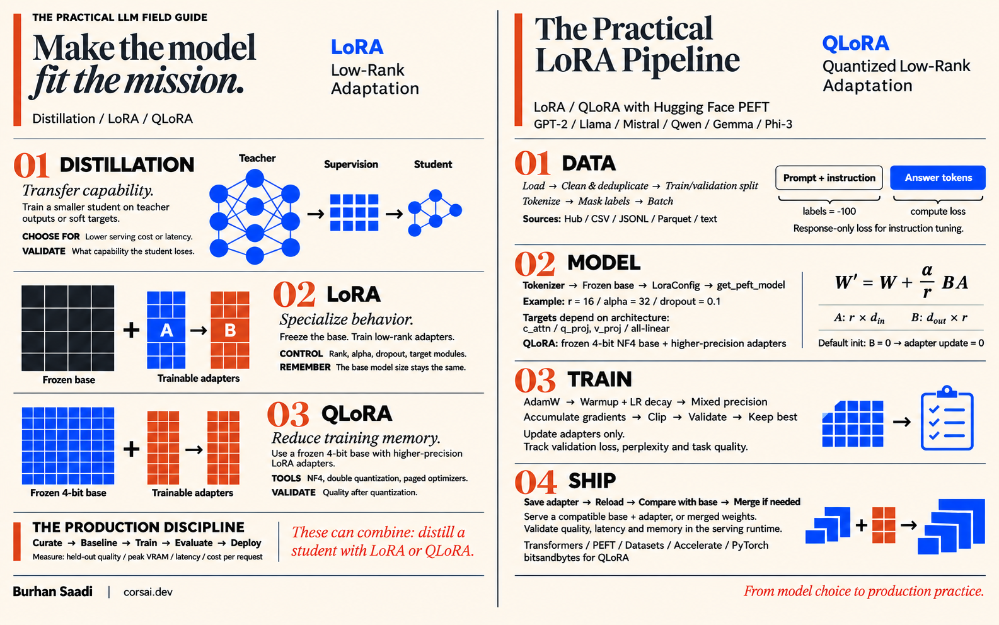
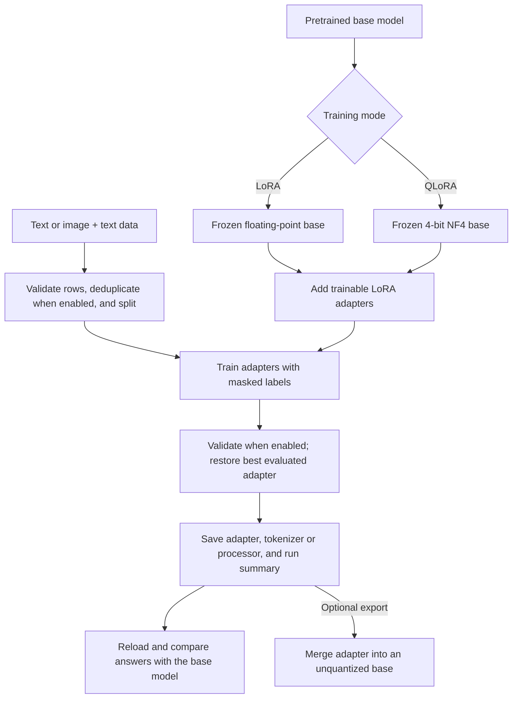

# 🧠 LoRA & QLoRA Fine-Tuning Templates — Text and Vision

[](https://www.python.org/)
[](https://pytorch.org/)
[](https://huggingface.co/docs/transformers/)
[](https://huggingface.co/docs/peft/)
[](#testing--verification)
[](LICENSE)

Two readable Python templates for fine-tuning Hugging Face models with **LoRA** or **QLoRA**:
one for **text-only language models**, and one for **vision-language models that answer questions
about images**. Start with the built-in examples, then change the model, dataset, and training
settings through command-line flags or a JSON/YAML file.

Each script contains the complete workflow: load data, prepare the model, train adapters, evaluate,
save, reload, and compare generated answers with the base model. Small LoRA examples can run on a
CPU; the QLoRA path in these templates uses an NVIDIA CUDA GPU.

**Built & shared by Burhan Saadi - [stackwander](https://github.com/stackwander).**

See the [Disclaimer](#disclaimer) for user responsibilities and limitations of liability.

## Contents

- [Illustrated Guide: LoRA, QLoRA & Distillation](#illustrated-guide-lora-qlora--distillation)
- [Choose a Script & Training Mode](#choose-a-script--training-mode)
- [Getting Started](#getting-started)
- [Run Your First Fine-Tune](#run-your-first-fine-tune)
- [Train on Your Own Data](#train-on-your-own-data)
- [Run QLoRA on a CUDA GPU](#run-qlora-on-a-cuda-gpu)
- [Configuration](#configuration)
- [Test, Reuse & Merge an Adapter](#test-reuse--merge-an-adapter)
- [How Training Works](#how-training-works)
- [Repository Structure](#repository-structure)
- [Testing & Verification](#testing--verification)
- [Troubleshooting](#troubleshooting)
- [Scope & Model Compatibility](#scope--model-compatibility)
- [Contributing](#contributing)
- [Disclaimer](#disclaimer)
- [License](#license)

---

## Illustrated Guide: LoRA, QLoRA & Distillation



## Choose a Script & Training Mode

### Which script should I use?

| Your data / task | Script | Examples |
| :--- | :--- | :--- |
| Text, instructions, or conversations | [`best-LORA-Example.py`](best-LORA-Example.py) | Instruction following, domain writing, chat responses |
| Images with captions, questions, or conversations | [`best-VLM-LoRA-Example.py`](best-VLM-LoRA-Example.py) | OCR, image descriptions, visual question answering |

**Both scripts support both training modes.** Their filenames describe the kind of model they train.

| | LoRA | QLoRA |
| :--- | :--- | :--- |
| What is trained? | Small adapter matrices | Small adapter matrices |
| Frozen base weights | Floating point | 4-bit NF4, with double quantization |
| Main benefit | Simple adapter training | Lower memory use for the base weights |
| Hardware in these templates | CPU, NVIDIA CUDA, or Apple MPS | NVIDIA CUDA GPU + `bitsandbytes` |
| How to select it | Default; omit `--use_qlora` | Add `--use_qlora` |

An **adapter** stores the learned changes. You still need the matching base model to use it.
QLoRA reduces base-weight memory; images, activations, sequence length, and batch size still matter.

## Getting Started

### 1. Create a Python environment

Clone or download this repository and open a terminal in its folder. Use **Python 3.11 or newer**;
the recorded test environment uses Python 3.13.1. On systems where the command is `python3`, use
that in place of `python` below.

```sh
python -m venv .venv
```

Activate it in **Windows PowerShell**:

```powershell
.\.venv\Scripts\Activate.ps1
```

Or in **Linux / macOS**:

```sh
source .venv/bin/activate
```

### 2. Install PyTorch and the libraries

Use the [official PyTorch installer](https://pytorch.org/get-started/locally/) to select a build for
your operating system and hardware. Choose **CUDA** for GPU QLoRA. A CPU-only PyTorch installation
cannot use an NVIDIA GPU just by installing `bitsandbytes`.

For a **CPU-only Windows or Linux demo**, the install command is:

```sh
python -m pip install torch --index-url https://download.pytorch.org/whl/cpu
```

On **macOS**, install the macOS build instead:

```sh
python -m pip install torch
```

Then install the shared libraries. These versions match the recorded regression-test environment:

```sh
python -m pip install "transformers==5.12.1" "peft==0.19.1" "datasets==5.0.0" "accelerate==1.14.0" "pillow==12.2.0"
```

For **QLoRA**, also install:

```sh
python -m pip install "bitsandbytes==0.50.2"
```

Optional extras: `pyyaml` for YAML configuration, `zstandard` for `.zst` data files, and
`num2words` for SmolVLM 2. Install only the extras your chosen model or data format needs.

### 3. Check the environment

```sh
python -c "import torch; print('PyTorch:', torch.__version__); print('CUDA available:', torch.cuda.is_available())"
python best-LORA-Example.py --help
python best-VLM-LoRA-Example.py --help
```

The default public models and datasets do not require an API key. For a gated or private Hugging
Face model, obtain access to its repository and authenticate with [`hf auth login`](https://huggingface.co/docs/huggingface_hub/guides/cli).

## Run Your First Fine-Tune

### Text: GPT-2 on instructions

```sh
python best-LORA-Example.py
```

### Vision: SmolVLM on image-to-LaTeX examples

```sh
python best-VLM-LoRA-Example.py
```

| Default | Text script | Vision script |
| :--- | :--- | :--- |
| Base model | `gpt2` | `HuggingFaceTB/SmolVLM-256M-Instruct` |
| Dataset | `databricks/databricks-dolly-15k` | `unsloth/LaTeX_OCR` |
| Training mode | LoRA | LoRA |
| Training sample limit | 1,000 | 300 |
| Validation sample limit | 200 | 40 |
| Epochs | 3 | 1 |
| Maximum sequence length | 256 tokens | 1,024 tokens, including image tokens |
| Saved output | `my_lora_adapter/` | `my_vlm_lora_adapter/` |

The first run downloads the model and dataset. **Sample limits limit training rows, not necessarily
the amount downloaded.** Runtime and memory use depend on the model, data, and hardware.

For a shorter text smoke run:

```sh
python best-LORA-Example.py --max_train_samples 32 --max_eval_samples 8 --max_steps 2 --per_device_train_batch_size 2 --output_dir outputs/text-smoke
```

These are demonstration settings. A successful run checks the workflow; useful task performance
needs representative data and evaluation of the generated answers.

## Train on Your Own Data

Both scripts accept Hugging Face dataset IDs, local data files, and folders saved with
`Dataset.save_to_disk()`. The vision script also supports image folders with metadata.

| Source / format | Text | Vision |
| :--- | :--- | :--- |
| Hugging Face dataset or local dataset folder | Yes | Yes |
| JSON, JSONL / NDJSON, CSV / TSV, Parquet, Arrow | Yes | Yes |
| TXT: one example per line | Yes | No |
| `save_to_disk()` folder | `--load_from_disk_path` | `--load_from_disk_path` |
| Streaming | `--streaming --max_steps N` | `--streaming --max_steps N` |

Column names are detected automatically. Use `--dataset_format` and the matching `--*_column`
flags if your dataset uses different names. When several sources are configured, the priority is
`load_from_disk_path` → `train_file` → `dataset_name`.

### Text instructions

Create `data/train.jsonl`, with **one JSON object per line**:

```jsonl
{"instruction":"Explain LoRA in one sentence.","input":"","output":"LoRA trains small adapter matrices while keeping the base model frozen."}
{"instruction":"Rewrite this message politely.","input":"Send the report now.","output":"Could you please send the report when you have a moment?"}
```

Create `data/validation.jsonl` with separate examples:

```jsonl
{"instruction":"Explain what a model adapter contains.","input":"","output":"An adapter contains learned parameter changes that are used alongside a base model."}
```

Train and save to a named folder:

```sh
python best-LORA-Example.py --train_file data/train.jsonl --validation_file data/validation.jsonl --dataset_format instruction --max_train_samples 0 --max_eval_samples 0 --output_dir outputs/text-local
```

Only answer tokens contribute to the instruction-training loss. `input` is optional. The few rows
above illustrate the format; use a larger, varied dataset for actual training.

<details>
<summary><strong>Other text layouts: raw text and chat</strong></summary>

**Raw text** trains on the text tokens:

```jsonl
{"text":"LoRA keeps the base weights frozen and learns an additional low-rank update."}
```

Save rows as `data/text.jsonl` and select `--dataset_format text`. A `.txt` file also works, with
one example per line. For substantial text corpora, `--packing` concatenates examples into full
blocks. The incomplete tail of each map batch is dropped, so very small files may produce no blocks.

**Chat** trains on assistant turns:

```jsonl
{"messages":[{"role":"user","content":"What does QLoRA change?"},{"role":"assistant","content":"It loads the frozen base weights in 4-bit and trains LoRA adapters."}]}
```

Save chat rows as `data/chat.jsonl` and select `--dataset_format chat`. The tokenizer's chat template
is used; a plain fallback is supplied when the text tokenizer has none. ShareGPT-style
`conversations` with `from` / `value` turns are also accepted.

</details>

### Images with questions and answers

Put your own images in `data/images/`. Create `data/train-vqa.jsonl`:

```jsonl
{"image":"red-square.png","question":"What color is the square?","answer":"Red."}
{"image":"blue-square.png","question":"What color is the square?","answer":"Blue."}
```

Create `data/validation-vqa.jsonl` with a different image:

```jsonl
{"image":"green-square.png","question":"What color is the square?","answer":"Green."}
```

The image files are supplied by you; replace the example filenames and answers with your data.
Relative paths are resolved from `--image_root`:

```sh
python best-VLM-LoRA-Example.py --train_file data/train-vqa.jsonl --validation_file data/validation-vqa.jsonl --image_root data/images --dataset_format vqa --output_dir outputs/vlm-local
```

<details>
<summary><strong>Other vision layouts: captions, chat, and high-bit-depth images</strong></summary>

**Captions** pair an image with target text:

```jsonl
{"image":"bicycle.jpg","text":"A red bicycle leaning against a brick wall."}
```

Use `--dataset_format caption --instruction "Describe this image."`. **Change `--instruction` for
your task:** the default asks for a LaTeX representation, because the built-in demo is OCR data.

**Multimodal chat** pairs images with conversation turns:

```jsonl
{"images":["bicycle.jpg"],"messages":[{"role":"user","content":[{"type":"image"},{"type":"text","text":"What is shown?"}]},{"role":"assistant","content":[{"type":"text","text":"A red bicycle."}]}]}
```

Use `--dataset_format chat`. Multiple images and string content with `<image>` placeholders are
supported. Placeholder counts must match the image list. In multi-image conversations, this
template trains assistant turns **after the last image**; earlier assistant turns remain context.

**Image inputs** can be embedded dataset images, file paths, HTTP(S) URLs, or `.npy` arrays. Download
large URL-based image collections locally first to avoid fetching images again every epoch.

**16-bit / 32-bit / floating-point images** are converted to 8-bit RGB before processing. The default
`--image_scaling percentile` stretches each image's contrast. For a shared detector range, use
`--image_scaling fixed --image_value_range 0 4095` instead. Repeat the same scaling and resolution
settings at inference. Vendor-specific microscopy formats should be exported to TIFF or `.npy` first.

</details>

If no validation split is supplied, the scripts normally hold out 5% of the training data. Keep
training and validation examples distinct. Set `--eval_strategy no` to use the data without a
validation holdout. `--max_train_samples 0` removes the training sample cap.

## Run QLoRA on a CUDA GPU

First confirm that `torch.cuda.is_available()` prints `True` and that `bitsandbytes` is installed.
These starting configurations use small micro-batches and gradient checkpointing. Adjust them to
your GPU and data; they do not guarantee a particular VRAM requirement.

### Text QLoRA

Save this as `text-qlora.json`. It uses the default Dolly instruction dataset:

```json
{
  "model_name": "Qwen/Qwen2.5-0.5B-Instruct",
  "use_qlora": true,
  "lora_target_modules": ["all-linear"],
  "gradient_checkpointing": true,
  "per_device_train_batch_size": 1,
  "per_device_eval_batch_size": 1,
  "gradient_accumulation_steps": 8,
  "max_seq_length": 512,
  "max_train_samples": 1000,
  "num_epochs": 1,
  "learning_rate": 0.0002,
  "output_dir": "outputs/text-qlora"
}
```

```sh
python best-LORA-Example.py text-qlora.json
```

`all-linear` follows the [PEFT QLoRA recipe](https://huggingface.co/docs/peft/developer_guides/quantization#qlora-style-training)
by adapting attention and MLP linear layers. Without an explicit target list, the text script uses
PEFT's architecture defaults.

### Vision QLoRA

Save this as `vlm-qlora.json`. It uses the default image-to-LaTeX dataset:

```json
{
  "model_name": "Qwen/Qwen2.5-VL-3B-Instruct",
  "use_qlora": true,
  "gradient_checkpointing": true,
  "per_device_train_batch_size": 1,
  "per_device_eval_batch_size": 1,
  "gradient_accumulation_steps": 8,
  "image_longest_edge": 512,
  "max_seq_length": 2048,
  "max_train_samples": 300,
  "num_epochs": 1,
  "output_dir": "outputs/vlm-qlora"
}
```

```sh
python best-VLM-LoRA-Example.py vlm-qlora.json
```

The VLM default adapts the language model's attention and MLP layers while keeping the vision
encoder and projector frozen. Setting `lora_target_modules` to `["all-linear"]` also adapts the
vision side and increases the trainable parameter count.

## Configuration

Change the defaults in each script's `ScriptConfig`, pass command-line flags, or supply a single
JSON/YAML file. **A configuration file must be the only argument after the script name**; edit the
file rather than appending flags to that command.

| Setting | What it controls |
| :--- | :--- |
| `--model_name` | Base-model Hugging Face ID or local model folder |
| `--dataset_name` / `--train_file` | Hub/local dataset or training file |
| `--validation_file` | Separate validation file, used with `--train_file` |
| `--dataset_format` | Text: `text`, `instruction`, `chat`; vision: `caption`, `vqa`, `chat` |
| `--max_train_samples` / `--max_eval_samples` | Sample caps; `0` means all in ordinary non-streaming runs |
| `--max_seq_length` | Token budget; includes image tokens for VLMs |
| `--per_device_train_batch_size` | Examples in one training micro-batch |
| `--gradient_accumulation_steps` | Micro-batches per optimizer step |
| `--gradient_checkpointing` | Lower activation memory by recomputing during backward |
| `--lora_r` / `--lora_alpha` / `--lora_dropout` | Adapter capacity, scaling, and regularization |
| `--learning_rate` / `--num_epochs` | Learning rate and passes over the training data |
| `--max_steps` | Override the number of epochs; required for streaming |
| `--eval_strategy` | `epoch`, `steps`, or `no`; step evaluation also uses `--eval_steps` |
| `--early_stopping_patience` | Evaluations without sufficient improvement before stopping; `0` disables it |
| `--mixed_precision` | `auto`, `no`, `bf16`, or `fp16`; `auto` selects for the device |
| `--image_root` / `--image_longest_edge` | Vision image-path base and input resolution |
| `--output_dir` | Adapter, tokenizer/processor, and run-summary destination |

Effective batch size on one device is **micro-batch size × gradient accumulation steps**. For
example, batch size `1` and accumulation `8` give eight sequences per optimizer step.

Use `--model_revision` and `--dataset_revision` to pin Hub revisions when reproducing an experiment.
Run either script with `--help` for the complete option list and defaults.

<details>
<summary><strong>Stream a large text dataset</strong></summary>

```sh
python best-LORA-Example.py --dataset_name HuggingFaceFW/fineweb-edu --dataset_config_name sample-10BT --dataset_format text --streaming --packing --max_steps 100 --max_train_samples 0 --max_eval_samples 64 --output_dir outputs/text-stream
```

Streaming reads data lazily and requires `--max_steps`. When evaluation is enabled, keep
`--max_eval_samples` positive. Without a separate validation split, the first validation rows are
held out before training; they are not a random sample of the entire stream. An empty stream or a
pass containing no usable target tokens stops with an error rather than repeating forever.

</details>

## Test, Reuse & Merge an Adapter

After training, the scripts reload the saved adapter and generate answers. By default they also
generate with the adapter disabled, so you can compare against the base model.

### Test a saved text adapter

```sh
python best-LORA-Example.py --do_train false --output_dir outputs/text-local --test_prompt "Explain LoRA in one sentence."
```

### Test a saved vision adapter

```sh
python best-VLM-LoRA-Example.py --do_train false --output_dir outputs/vlm-local --test_image data/images/green-square.png --test_prompt "What color is the square?"
```

The base-model ID is read from the saved adapter configuration. Keep the adapter's tokenizer or
processor files and `run_summary.json` together with the weights. For vision inference, repeat
the image scaling and resolution settings used during training.

### Keep QLoRA inference in 4-bit

Repeat `--use_qlora` when running inference; the saved training flag is not automatically selected:

```sh
python best-LORA-Example.py --do_train false --output_dir outputs/text-qlora --use_qlora --test_prompt "Explain QLoRA in one sentence."
python best-VLM-LoRA-Example.py --do_train false --output_dir outputs/vlm-qlora --use_qlora --image_longest_edge 512 --test_image data/images/formula.png --test_prompt "Write the LaTeX representation for this image."
```

Replace `formula.png` with your own test image. Omitting `--use_qlora` loads an unquantized base and
can require substantially more memory.

### Export a merged model

```sh
python best-LORA-Example.py --do_train false --output_dir outputs/text-local --save_merged_model
python best-VLM-LoRA-Example.py --do_train false --output_dir outputs/vlm-local --test_image data/images/green-square.png --test_prompt "What color is the square?" --save_merged_model
```

The merged model is saved beside the adapter folder, with `-merged` appended, for example
`outputs/text-local-merged/`. Load a merged text model with `AutoModelForCausalLM`, or a merged VLM
with `AutoModelForImageTextToText`.

**For QLoRA, `--save_merged_model` explicitly reloads an unquantized base**, even if `--use_qlora`
is supplied. Export therefore needs memory and disk space for the full base model. Keep the
adapter-only output when you want the smaller artifact.

## How Training Works



- **Data:** detect layouts, remove malformed examples, deduplicate ordinary non-streaming training
  data when enabled, and create or use a validation split. Text supports optional token packing;
  images are decoded and processed per batch.
- **Model:** freeze base weights and inject LoRA adapters. QLoRA adds NF4 loading, double
  quantization, and k-bit preparation before adapter training.
- **Training:** AdamW on trainable parameters, warmup and scheduling, token-weighted gradient
  accumulation, clipping, mixed precision, and optional gradient checkpointing.
- **Evaluation:** held-out loss and perplexity, optional early stopping, and restoration of the best
  evaluated adapter. Instruction prompts, padding, and VLM image tokens are excluded from the loss.
- **Saving:** adapter weights and configuration, tokenizer/processor files, and `run_summary.json`
  containing training settings, package versions, and evaluation history. Validation checkpoints
  are stored in `checkpoint-best/` when a new best is found.

## Repository Structure

```text
.
├── best-LORA-Example.py              # Text LoRA / QLoRA template
├── best-VLM-LoRA-Example.py          # Vision-language LoRA / QLoRA template
├── best-LORA-Example_User_Manual.pdf # Additional text-template walkthrough
├── tests/
│   └── test_lora_templates.py        # Offline regression and tiny-model checks
├── LICENSE                          # Apache License 2.0
└── README.md
```

The [PDF manual](best-LORA-Example_User_Manual.pdf) provides additional background. Use each script's
`--help` and `ScriptConfig` for its current flags and defaults.

## Testing & Verification

With the shared libraries installed, run:

```sh
python -B -m unittest discover -s tests -v -b
```

The tests create tiny GPT-2 and LLaVA models locally and use temporary data. They do not download
model checkpoints or datasets. Coverage includes adapter-only updates, training with checkpointing
on/off, save/reload consistency, merged exports, empty/masked streams, repeated streaming passes,
interrupt handling, and QLoRA loading configuration. The NF4 configuration test is skipped if the
optional `bitsandbytes` package is absent.

**Recorded on 9 November 2026:** all nine regression tests passed, including four text/VLM
training, reload, and export combinations with gradient checkpointing on/off.

| Component | Recorded version |
| :--- | :--- |
| Python | 3.13.1 |
| PyTorch | 2.12.1, CPU build |
| Transformers / PEFT | 5.12.1 / 0.19.1 |
| Datasets / Accelerate | 5.0.0 / 1.14.0 |
| Pillow | 12.2.0 |
| bitsandbytes | 0.50.2; configuration checks |

**CUDA mixed precision and actual 4-bit GPU execution have not been validated on this CPU test
machine.** QLoRA configuration checks use mocked CUDA loading; they are not GPU training tests.
Run a short trial on your target GPU before a longer job.

## Troubleshooting

| Symptom | What to check |
| :--- | :--- |
| `CUDA available: False` on an NVIDIA machine | NVIDIA driver and the CUDA-enabled PyTorch build selected during installation |
| QLoRA reports a missing package | Install `bitsandbytes` in the same virtual environment used to run the script |
| CUDA out of memory | Lower both train/eval micro-batch sizes; reduce sequence length or image resolution; enable checkpointing or QLoRA |
| No training batch / no target tokens | Inspect the data layout and filtering. Increase the token budget if the prompt fills it; reduce VLM image resolution if necessary |
| Layout cannot be detected | Set `--dataset_format` and the appropriate text, answer, messages, or image column flags |
| Image file not found | Check `--image_root`, relative paths, and that the files exist |
| Caption model is asked for LaTeX | Set `--instruction` to your captioning task, such as `"Describe this image."` |
| No adapter in the output folder | Point `--output_dir` to a completed saved adapter, or train one first |
| JSON config plus extra flags fails | Pass only the config filename, or use command-line flags without a config file |
| Training fits, but reload/export does not | Repeat `--use_qlora` for 4-bit inference; merged exports deliberately require an unquantized base |
| PowerShell blocks virtual-environment activation | Use `.\.venv\Scripts\python.exe` instead of `python` for installation and script commands |
| Hugging Face download is denied | Check model access, authentication, repository ID, and network access |

## Scope & Model Compatibility

These templates provide single-device fine-tuning workflows for learning, research, and use in
your own applications. They implement the training loop directly so the steps are visible and
editable. Assess and adapt them to your requirements before deployment.

- **Text:** decoder-only causal language models such as GPT-2, Llama, Mistral, Qwen, Gemma, and
  SmolLM. Encoder-only BERT/RoBERTa and encoder-decoder T5 need different model and task wrappers.
- **Vision:** compatible instruction VLMs with a chat template, such as SmolVLM, Qwen-VL, and
  LLaVA. Support depends on the architecture and processor; changing the model ID is not a
  guarantee of compatibility. Llama 3.2 Vision's per-token cross-attention inputs and models
  without a suitable chat template, such as base PaliGemma, are refused by this template.
- **Training scope:** single-device adapter tuning. Distributed DDP/FSDP, optimizer/scheduler-state
  resume, experiment dashboards, and task-specific evaluation metrics are not implemented.
  An adapter checkpoint is not a resumable training-state checkpoint.
- **Quality:** inspect held-out answers as well as loss. Short examples and defaults demonstrate
  mechanics; they do not establish accuracy for a new task.

## Contributing

Issues and pull requests are welcome. Include the script name, model ID, package versions,
hardware, and a minimal data example when reporting a problem. Run the offline regression tests
before submitting code changes, and state whether any CUDA checks were performed on real hardware.

## Disclaimer

This project may be used for personal, research, or commercial purposes, subject to the
[Apache License 2.0](LICENSE) and applicable third-party terms. **Use it at your own risk.**

You are responsible for how you use, modify, train with, distribute, or deploy this work, including:

- The data and models you select, your rights to use them, and compliance with applicable laws,
  licenses, privacy requirements, and contractual obligations.
- Evaluating model outputs for accuracy, bias, safety, and suitability before relying on them
  or making them available to others.
- Deployment decisions, security controls, backups, resource consumption, and any hardware,
  storage, cloud, or other costs you incur.
- The consequences of your use or misuse, including decisions or actions based on generated outputs.

The creator and contributors do not control or endorse downstream uses, trained models, or
generated outputs. The software and documentation are provided **"as is"**, without guarantees
of results, accuracy, reliability, security, compatibility, or fitness for a particular purpose.

To the extent permitted by applicable law, and subject to the exceptions and terms in Sections 7
and 8 of the [Apache License 2.0](LICENSE), the creator and contributors disclaim warranties and
liability for claims, losses, damages, or other consequences arising from use, misuse, modification,
distribution, or inability to use this work. This includes data loss, service disruption, financial
loss, and consequences of model outputs or deployments.

This notice summarizes user responsibilities and the license's warranty and liability provisions;
it does not replace or amend the license.

## License

Copyright (c) 2026 **Burhan Saadi**. Released under the [Apache License, Version 2.0](LICENSE).

The Apache License 2.0 covers this project's source code. Models, datasets, and dependencies retain
their respective licenses.
